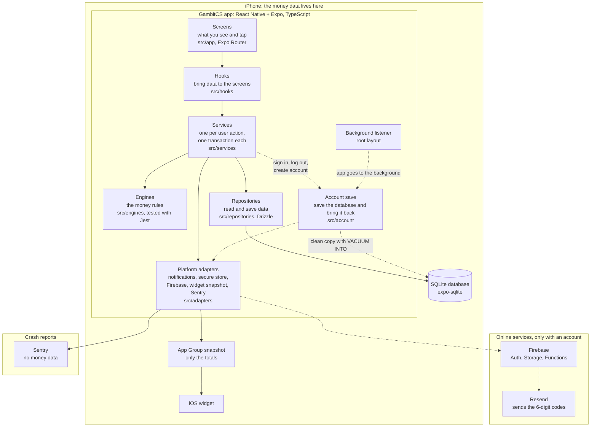
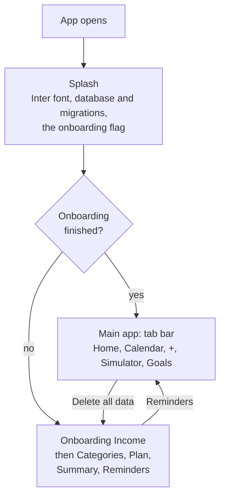
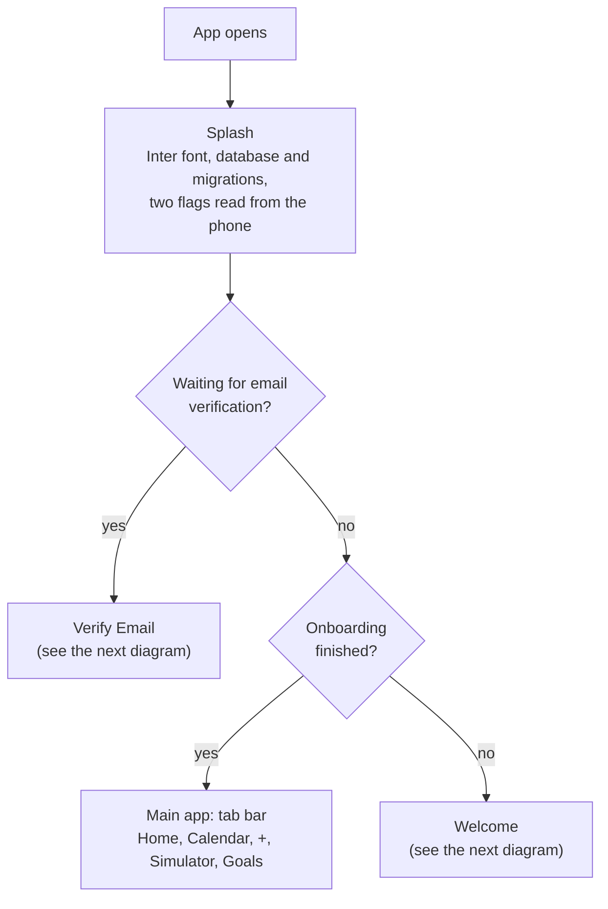
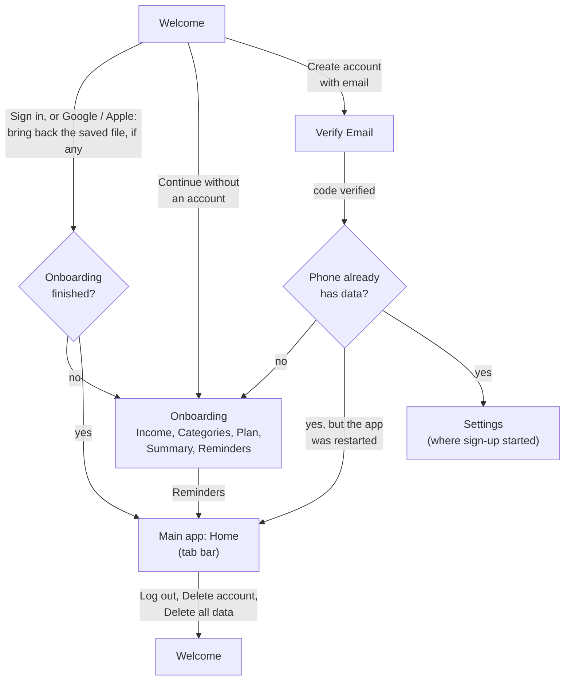

# GambitCS — Architecture

Last updated: November 17, 2026 (Day 1 of the development plan); §6 updated November 19, 2026 (Day 2); §3 updated November 25, 2026 (Day 3)

How GambitCS is put together: the layers, where each file goes, how the user moves between screens, and where the widget and Firebase plug in. It doesn't repeat the details that live elsewhere:

| Topic | Where |
|---|---|
| What the app does (product rules) | `GambitCS_Decisions_Update.md` (Claude Project) |
| How it looks | `GambitCS_Design_Spec.md` (Claude Project) and the Claude Design canvas **GambitCS — Simulator** |
| Tech choices, backend and security | `GambitCS_Tech_Decisions.md` (Claude Project) |
| Tables and fields | `docs/DATA_MODEL.md` (Day 2) |
| Small decisions made while coding | `docs/decisions.md` |

---

## 1. Overview

- **Local-first.** All the money data (income, categories, plans, expenses, goals, balance) lives in a SQLite database on the phone. The app works fully without an account and without internet.
- **The account is optional.** With one, the app saves a copy of the database to the account on its own, and signing in on a new phone brings it back. No live sync between phones.
- **Firebase only, for accounts.** Auth, Cloud Storage (the saved copy), 6 Cloud Functions, and Firestore for the email codes only. No server of our own. Built in v1.3.
- **iOS first.** React Native + Expo (TypeScript), so the same code runs on Android; check the Android emulator now and then.
- **Two languages.** Every text the user sees goes through i18next (English and Spanish).

Stack: Expo Router, NativeWind, Lucide icons, expo-sqlite + Drizzle ORM, i18next + expo-localization, expo-secure-store, Sentry, EAS Build → TestFlight. Firebase and Resend come in v1.3. Full list and reasons: Tech decisions §1.

---

## 2. Layers

Each layer only talks to the ones below it. Dashed lines are only used with an account.



| Layer | Folder | Job | Can use |
|---|---|---|---|
| Screens | `src/app/` | What the user sees and taps. Each file is a route (Expo Router). | Hooks, components |
| Components | `src/components/` | Shared UI pieces: buttons, money field, sheets, tab bar, GambitLogo. A whole screen used by two routes (Activity) lives here too. | Only what the screen passes in |
| Hooks | `src/hooks/` | Bring data to the screens and hand user actions to services (`useWeekSummary`, `useGoals`). | Services |
| Services | `src/services/` | One per user action (`addExpense`, `moveToGoal`, `updateBalance`, `signIn`, `logOut`), and **one database transaction per action**: all its writes happen, or none do. Move it to a goal, for example, lowers this week's budget and adds the contribution together. The only place that brings engines, repositories, adapters and `account/` together. | Engines, repositories, adapters, `account/`, `lib/`, `types/` |
| Engines | `src/engines/` | The money rules, plain TypeScript: **calendar** (weeks, the Sunday month rule, bill and payday dates), **plan** (Tight / Balanced / Easy, interpolation, $85 minimum, the cap), **ledger** (weekly budget, Left, carry-over, over-budget options, netting), **goals** (To goals / After goals, the weekly amount from a target date, contributions, and the "Tight margin" and "Your goals take more than you save" warnings that show inline in the Create / Edit goal form). | `lib/` and `types/` only: no React, no database, no phone features |
| Types | `src/types/` | The app's own types: `Week`, `Plan`, `Goal`, `Entry`, money in cents. Engines and every other layer share them. The fields come with `DATA_MODEL.md`. | Nothing |
| Repositories | `src/repositories/` | Read and save data with Drizzle, one per group of tables, and turn database rows into the app's types. | `db/`, `types/` |
| Database | `src/db/` | Drizzle schema, migrations, the database provider, seed data. The database row types come from the schema (Drizzle makes them), so they aren't written by hand and don't live in `types/`. | — |
| Account save | `src/account/` | Save the database to the account and bring it back (v1.3). See §5.2. | `db/`, adapters |
| Adapters | `src/adapters/` | Everything that talks to the phone or the internet: notifications, secure store, Firebase (Auth, Storage, Functions), the widget snapshot, Sentry. | Outside libraries |
| Helpers | `src/lib/` | Small helpers: money in cents, dates as local days. | Nothing |
| Languages | `src/i18n/` | `en.json`, `es.json` and the i18next setup. | — |

**The rules that keep it clean**
- A screen never touches the database. It gets data and actions from hooks.
- Components get their data only from the screen that uses them, so they can be reused anywhere.
- Engines import nothing but `lib/` and `types/`. That's why Jest can test them on the Mac without a phone, against the sample numbers in the Decisions update, and why a change to a table never breaks a money rule.
- One user action = one transaction. Every transaction, and the account copy, goes through **one write queue**, one at a time (§5.2).
- No screen and no feature hook starts an account save (§5.2).

---

## 3. Folder structure

```
gambitcs/
├── src/
│   ├── app/                Screens (Expo Router), see §4.5
│   ├── components/         Shared UI: buttons, money field, sheets, tab bar, GambitLogo
│   ├── hooks/              Bring data to the screens: useWeekSummary, useGoals
│   ├── services/           One per user action: addExpense, moveToGoal, signIn, logOut
│   ├── engines/            The money rules, plain TypeScript, tested with Jest
│   │   ├── calendar/       Weeks, the Sunday month rule, bill and payday dates
│   │   │   ├── calendar.ts
│   │   │   └── calendar.test.ts
│   │   ├── plan/           Tight / Balanced / Easy, interpolation, $85 minimum, the cap
│   │   │   ├── plan.ts
│   │   │   └── plan.test.ts
│   │   ├── ledger/         Weekly budget, Left, carry-over, over-budget options, netting
│   │   │   ├── ledger.ts
│   │   │   └── ledger.test.ts
│   │   └── goals/          To goals / After goals, weekly amount from a date, warnings
│   │       ├── goals.ts
│   │       └── goals.test.ts
│   ├── types/              The app's own types: Week, Plan, Goal, Entry (imports nothing)
│   ├── repositories/       Read and save data with Drizzle, one per group of tables
│   ├── db/                 Drizzle schema, migrations, database provider, seed data
│   ├── account/            Save the database to the account and bring it back
│   ├── adapters/           Notifications, secure store, Firebase (Auth, Storage,
│   │                       Functions), widget snapshot, Sentry
│   ├── i18n/               en.json, es.json and the i18next setup
│   └── lib/                Small helpers
│       ├── money.ts        Money in cents
│       ├── money.test.ts
│       ├── dates.ts        Dates as local days
│       └── dates.test.ts
├── functions/              Backend: Firebase Cloud Functions and emulator tests (v1.3)
│   └── src/                One file per function + shared helpers
├── widget/                 iOS widget (later; name depends on expo-widgets vs Swift)
├── docs/                   ARCHITECTURE.md, DATA_MODEL.md, decisions.md
├── assets/                 Inter font, logo, app icon
├── .github/                GitHub Actions workflow, pull request and issue templates
├── .husky/                 Git hooks: lint and format before each commit
├── firebase.json           Firebase setup: functions, rules, emulators
├── firestore.rules         Firestore closed to the app
├── storage.rules           Each user only reaches their own folder
├── README.md, CHANGELOG.md, SECURITY.md
└── app.config.ts, eas.json, tsconfig.json, tailwind.config.js, drizzle.config.ts,
    package.json, .env.example
```

- **Tests sit next to the file they test** (`plan.test.ts` next to `plan.ts`). An engine can grow to several files; each gets its own test. **Never inside `src/app/`**: Expo Router treats every file there as a route, so a test file would become a broken screen. Screen tests, if any, go in a separate folder.
- **Engine tests use the sample numbers in the Decisions update**, for example: calendar, September 2026 = Aug 31–Sep 27 and the daylight saving changes; plan, $165 / $115 / $45 a week, cap $270, $547 with Freelance, $180 with Groceries pinned at $90; ledger, weeks of $273 / $295 / $230, September $2,328, $264.67 and $248 for the over-budget options, $12 net over, $8 net under; goals, To goals $50 and After goals $65, a $60 goal leaves $5 (Tight margin), an $80 goal leaves −$15 (goals take more than you save).
- **Created on their own:** `ios/` (from `npx expo run:ios`, rebuilt from `app.config.ts`, left out of Git), `node_modules/`, `.expo/`.
- **Path alias:** `@/` points to `src/`, so imports read `@/engines/plan`.
- **Folders are created with their first file** (November 25, 2026, Day 3). The tree above is the map: a folder appears in the repository on the day its first file arrives, so there are no empty placeholder folders.
- **No `LICENSE` file, on purpose** (November 25, 2026, Day 3). The repository is public so the code can be read, but all rights are reserved (see the README).
- The structure can change while building; when it does, update this file the same day.

---

## 4. Navigation map

The navigation map is every screen and how the user moves between them. §4.1–§4.4 describe it; §4.5 turns it into the files in `src/app/`.

### 4.1 Top level

**v1.0–v1.2 (no accounts yet).** No Welcome, no Auth: the app has only onboarding and the main app.



**From v1.3 (accounts): startup.**



**From v1.3 (accounts): from Welcome.**



**Three areas:** Auth (Welcome, Sign in, Sign up, Forgot password… 8 screens), Onboarding (5 steps) and the Main app (the tab bar). The "+" in the tab bar is a button that opens Add expense, not a tab.

**Above the tabs** (they cover the tab bar):

| Overlay | Opens from | How it appears | Closes to |
|---|---|---|---|
| Add expense | "+" on every screen | Sheet, slides up | Where you were |
| Quick add | Reminder notification | Sheet, slides up | Where you were (Home on a cold start) |
| Settings | Hamburger on Home | Full screen, slides in from the left; swipe right to left to close | Home, sliding out to the left |
| New-week pop-up | First time the app opens in a new week | Dialog over Home | Home |
| Move it to a goal | The pop-up's link | Full screen with a back arrow, no tab bar | Back → the pop-up; Save → Goal detail in the Goals tab |
| Goal completed | A goal reaches its target | Dialog | Where you were |

**Splash.** It's the screen the iPhone shows the instant the app is tapped (the G-mark). It stays up only while the app gets ready **using what's on the phone**: the Inter font loads, the database opens and the migrations run, and two flags are read, "onboarding finished" and "waiting for email verification" (saved at sign-up, cleared once the code is verified). It never waits for Firebase or the internet, so the app never hangs offline; Firebase restores the sign-in in the background afterwards. If something fails (a migration, say), the splash hides, an error screen shows and the error goes to Sentry.

**Where the app opens** (checked in this order, all on the phone):

| # | Check | Opens |
|---|---|---|
| 1 | (while checking) | Splash stays up |
| 2 | Waiting for email verification (from v1.3) | Verify Email |
| 3 | Onboarding finished | Home, signed in or not |
| 4 | Anything else | Welcome (Onboarding Income before v1.3) |

- **Reminder notification:** the app runs these checks first, opens Home, then shows Quick add on top. It works from a cold start too. If "onboarding finished" doesn't pass, the tap just opens the app normally. Log out and Delete all data cancel the scheduled reminders.
- **New-week pop-up:** checked when the app opens and when it comes back from the background, the first time in a new week.

**Moving between areas replaces the history.** Swiping back on Home never returns to onboarding, and after logging out you can't swipe back into Settings. Inside an area, screens stack normally.

**Before v1.3 (accounts)** there's no Welcome or Auth (first diagram): with no data on the phone, the Root opens Onboarding Income, and Delete all data goes back there. The auth files don't exist yet.

### 4.2 Inside each tab

- Each tab has its own stack; the back arrow returns to the previous screen in the same tab.
- The tab bar stays visible on every screen inside a tab.
- **Tapping a tab always opens its first screen**, including the tab you're already on (Design spec). React Navigation's default remembers where you were inside a tab, so this is set on purpose.

```
Home
 └── Activity              from "See all" (this week or month; back → Home)

Calendar (weeks list)
 ├── Monthly overview      from the Month button
 ├── Yearly overview       from the Year button
 │    └── Monthly overview from a month in the table
 └── Week detail           from any week card
      └── Activity         from "See activity" (that week; back → Week detail)

Simulator: Year view (Tight / Balanced / Easy)
 └── Month view            from a month
      └── Week view        from a week row
           ├ category sheet   from a category row or "Add category"
           └ income sheet     from an income row or "Add income"

Goals list                 (or "No goals yet": one screen, two states)
 ├── Create goal           from "New goal" / "Create a goal" (the method sheet opens first)
 └── Goal detail           from a goal card
      └── Edit goal        same form as Create goal
```

- **Activity is one screen shared by Home and Calendar.** It lives in whichever tab opened it, so the tab bar shows that tab and back returns to where the user was.
- **Simulator lock:** while a profit change is unsaved in Week view, the category rows, "Add category", income rows, "Add income", the back arrow, the swipe back and the whole tab bar ("+" included) are locked. The only ways out are Save or Cancel in the card.
- **Goals:** Save goal returns to the goals list; Save changes in Edit goal returns to Goal detail (no confirmation dialog). Saving in Move it to a goal opens Goal detail with the goals list under it, so back goes to the list.

### 4.3 Inside Auth, Onboarding and Settings

**Auth (from v1.3)**
```
Welcome
 ├── Sign in (email, Google or Apple)
 │    └── Forgot password → Check your email → Verify Email (reset code) → Reset password → Sign in
 ├── Create account (Google, Apple or Email)
 │    └── Sign up form (email) → Verify Email (sign-up code)
 └── Continue without an account → Onboarding Income
```
- **After any sign-in or sign-up from Welcome** (email, Google or Apple): if the account has a saved file, bring it back; then onboarding finished → Home, otherwise → Onboarding. It depends on what the account holds, not on the button tapped, because Google and Apple sign-in and sign-up are the same action.
- **After Verify Email** (a sign-up with email): if the phone has no data yet (sign-up from Welcome) → Onboarding; if it already has data (sign-up started from Settings) → back to Settings, or Home if the app was restarted before the code was typed. Google and Apple skip the code and follow the same split.
- **Verify Email** is one screen with two jobs (sign-up code or reset code).
- After Reset password, the reset screens are replaced by Sign in, so back can't return to the code screens. A wrong reset code returns to Verify Email with the error.

**Onboarding**
```
Income (1) → Categories (2) → Plan (3) → Summary (4) → Reminders (5) → Home
```
- Back goes to the previous step. Step 1's back returns to Welcome from v1.3; before that it has no back arrow.
- The Plan step's three states (normal, 3b, 3c) are one screen.
- **Editing from Summary:** the pencil opens that step on top of Summary in edit mode ("Save" instead of "Continue"); Save and back both return to Summary (back drops the changes).
- Reminders: "Enable reminders" and "Not now" both finish onboarding and open Home, replacing the history.

**Settings** (Settings 1 with an account, Settings 10 without one)
```
Settings
 ├── Income & categories     (Budget group)
 ├── Change password         (Account group, only with an account)
 └── Create account          (only without an account) → sign-up screens → back to Settings
```
- Settings is its own small stack above the tabs. Only Settings itself slides in from the left; screens inside it push from the right as usual. The tab bar stays hidden.
- Notifications, Language and the profile block don't open screens: they work in place or open sheets (§4.4).
- **Creating an account from Settings:** the sign-up screens open on top of Settings, the phone's data becomes the account's data, and they all close at once back to Settings. Their "Already have an account? Sign in" link is hidden here.
- **No Sign in from Settings, on purpose:** it would mix the phone's data with an account's data. Someone with an account who started without one uses Delete all data → Welcome → Sign in.

### 4.4 Sheets, pop-ups and dialogs

Kinds: **sheet** (slides up, usually a form with Save / Cancel), **dialog** (a box in the middle that asks or tells one thing), **tooltip** (closes when you tap outside), **system prompt** (drawn by iOS).

| Where | Opens from | What | Kind |
|---|---|---|---|
| Home | "i" on the Available card | Catch-up / pull-ahead explanation | Tooltip |
| Home | Account balance card | Update your balance ("Add your balance") | Sheet |
| Home, Activity | A Recent activity / Activity row | Edit expense / Edit income → "Delete this expense?" on top | Sheet + dialog |
| Activity | "Add an expense" on an empty day | Add expense | Sheet (above the tabs) |
| Add expense | Date pill; a merchant with no match | Date picker; add a new merchant | Inside the sheet |
| Calendar | — | Nothing: Week detail and the overviews are view-only | — |
| Simulator | Use this plan; Reset to default | Confirmation | Dialog |
| Simulator | A category row or "Add category" | Category sheet → "Delete Rent?" on top | Sheet + dialog |
| Simulator | An income row or "Add income" | Income sheet → "Remove Freelance?" on top | Sheet + dialog |
| Goals | "New goal" / "Create a goal" | "How do you want to save?" (weekly amount or target date) | Sheet |
| Goals | Goal detail: Add money | Add money (amount; shows as Extra in Contributions) | Sheet |
| Goals | Goal detail: Delete goal | Delete confirmation | Dialog |
| Goals | A goal reaches its target | Goal completed | Dialog (above the tabs) |
| Settings | Profile block; Frequency; Quiet hours | Edit your name; Notification frequency; Quiet hours | Sheet |
| Settings | Income & categories rows | The same category and income sheets as the Simulator | Sheet + dialog |
| Settings | Log out; Delete account; Delete all data | Confirmation | Dialog |
| Onboarding | An income source; a category | Income sheet; category sheet (Remove category asks nothing: nothing is saved yet) | Sheet |
| Onboarding | Enable reminders | Notification permission | System prompt |

**How they're built**
- **As their own screen in the navigation:** Add expense, Quick add, the new-week pop-up, Move it to a goal and Goal completed. Each opens from many places or from outside the app, or something opens on top of it. (A plain React Native `Modal` draws above everything, so Move it to a goal would open hidden behind a `Modal` pop-up.)
- **Inside their screen:** everything else. They open and close in place.
- **A dialog on top of a sheet** is built inside that sheet: on iPhone, two separate `Modal`s don't stack reliably.

**One pop-up at a time.** When several want to show at once, each waits for the one before to close:
1. Quick add, if the app was opened from the reminder
2. The new-week pop-up (and Move it to a goal, if the user taps the link)
3. Goal completed

### 4.5 The `src/app/` folder

Expo Router rules used here: `_layout.tsx` decides how a folder's screens behave (Stack or Tabs); `(name)` is a group that organizes files without changing the path; `index.tsx` is a folder's first screen; `[name]` is a value inside the path.

```
src/app/
├── _layout.tsx              Root stack: splash, startup checks, guards, overlays
├── (auth)/                  built in v1.3; doesn't exist before
│   ├── _layout.tsx
│   ├── welcome.tsx
│   ├── sign-in.tsx
│   ├── sign-up.tsx          Google, Apple or Email
│   ├── sign-up-email.tsx
│   ├── forgot-password.tsx
│   ├── check-email.tsx
│   ├── verify-email.tsx     ?purpose=signup or ?purpose=reset
│   └── reset-password.tsx
├── (onboarding)/
│   ├── _layout.tsx
│   ├── income.tsx           each step: ?from=summary for edit mode
│   ├── categories.tsx
│   ├── plan.tsx
│   ├── summary.tsx
│   └── reminders.tsx
├── (tabs)/
│   ├── _layout.tsx          Tabs with our own tab bar ("+" is a button, not a file)
│   ├── home/
│   │   ├── _layout.tsx
│   │   ├── index.tsx        Home
│   │   └── activity.tsx     Activity ◆  ?period=week&start=2026-09-07
│   ├── calendar/
│   │   ├── _layout.tsx
│   │   ├── index.tsx        Weeks list
│   │   ├── week/[start].tsx Week detail
│   │   ├── month/[month].tsx Monthly overview
│   │   ├── year/[year].tsx  Yearly overview
│   │   └── activity.tsx     Activity ◆
│   ├── simulator/
│   │   ├── _layout.tsx
│   │   ├── index.tsx        Year view
│   │   ├── month/[month].tsx Month view  ?plan=balanced
│   │   └── week/[start].tsx Week view   ?plan=balanced (locks during an unsaved profit change)
│   └── goals/
│       ├── _layout.tsx
│       ├── index.tsx        Goals list, or "No goals yet"
│       ├── new.tsx          Create goal
│       └── [goalId]/
│           ├── index.tsx    Goal detail
│           └── edit.tsx     Edit goal
├── settings/
│   ├── _layout.tsx          inner stack: screens push from the right
│   ├── index.tsx
│   ├── income-categories.tsx
│   └── change-password.tsx
├── add-expense.tsx          sheet
├── quick-add.tsx            sheet (the reminder opens /quick-add)
├── new-week.tsx             dialog
├── move-to-goal.tsx         full screen, no tab bar
├── goal-completed.tsx       dialog
└── dev/gallery.tsx          component gallery (Day 16), development builds only
```

- **Path vs. search params.** The path says *which thing* the screen shows (`week/[start]`, `month/[month]`, `year/[year]`, `[goalId]`). Search params say *how to show it or where it was opened from*: the Simulator's `?plan=` (without it, Month and Week views would fall back to the active plan and show the wrong one), Activity's `?period=&start=`, Verify Email's `?purpose=`, and onboarding's `?from=summary`.
- **Why the tabs are plain folders, not groups:** Calendar and the Simulator both have Month and Week screens. As groups they'd clash on the same path (`/week/...`); as folders they're `/calendar/week/...` and `/simulator/week/...`.
- **◆ Activity in two tabs:** the screen is built once in `components/`; `home/activity.tsx` and `calendar/activity.tsx` are tiny files that both show it. Expo Router's "shared routes" feature is the alternative; compare on Day 6.
- **File names are paths.** Renaming a file in `app/` changes its path, and things link to paths (the reminder opens `/quick-add`), so update those links too.

**What the root `_layout.tsx` does**
- **Splash and startup checks** (§4.1): keeps the splash up, runs the checks, opens the right area.
- **Guards:** any file in `app/` can be opened by a link, even with no button pointing to it. `(auth)` opens only when there's no data on the phone, or for sign-up from Settings. Screens the plan hides until their release can use the same guard. `dev/gallery` redirects to Home outside development builds.
- **Overlays:** each is declared here with its own way of appearing: sheet, dialog, full screen, and Settings sliding in from the left with a right-to-left swipe to close (a custom transition; the default iOS push and swipe-back go the other way).
- **Sign-up from Settings:** the root presents the sign-up screens as a modal on top of Settings and closes them all at once after verifying.
- **Background listener:** the one place that notices the app going to the background, for account saves (§5.2) and the new-week check.

---

## 5. Where the widget and Firebase plug in

### 5.1 iOS widget

- The widget can't open the app's database. After any change to this week's or month's numbers, a service asks the widget adapter to write a small **snapshot of the totals** into the iOS **App Group** that the app and the widget share. The widget only reads that snapshot: the totals it shows, never the list of expenses.
- It always shows the active plan. Small shows the week; medium shows the week and the month, plus the over-budget variant ("$X over this week").
- Built with `expo-widgets` (React components) or native Swift: still open (Tech decisions §9). Either way it lives in `widget/` and needs development builds (Expo Go can't run it). The Android widget is deferred.

### 5.2 Firebase and the account (v1.3)

- **Adapters** wrap the Firebase SDK: Auth (email and password, Google, Apple), Storage (the saved file) and Functions (the 6 Cloud Functions). Nothing else imports Firebase.
- **Services** run the steps of each flow: sign up → `requestVerifyCode` → Verify Email → `verifyEmail`; sign in → bring the data back → Home or onboarding; log out → save → remove the data from the phone; password reset; delete account.
- **The `account/` boundary**
  - It only **saves the database to the account and brings it back**, including upgrading an older file format when it's brought back. Nothing else.
  - Only two things start a save: **the app going to the background** (the one listener in the root layout, when something changed since the last save) and **the account services** (sign in brings back; log out saves first; creating an account from Settings makes the first save).
  - It uploads a **clean copy made with `VACUUM INTO`**, never the live database file, so a save can't catch the database in the middle of a write.
  - It **waits its turn in the write queue.** Every service transaction and the account copy go through one queue, one at a time. SQLite refuses `VACUUM INTO` while a transaction is open on the same connection (expo-sqlite uses one connection), and waiting also means the copy includes the action that just finished. The queue doesn't guess when it's safe: everything just waits its turn.
  - No screen and no feature hook (`useGoals`, say) ever starts a save.
- **Firestore** holds only the email codes, and the app has no access to it: only the Functions read and write it. **Resend** sends the codes, called from the Functions. Secrets live in Google Secret Manager.
- Saved files go to `backups/{uid}/{uploadTimeInMs}.backup` in Storage; the server keeps the newest 7. Details: Tech decisions §4–§7.

### 5.3 Sentry

Crash reports only, set up through `adapters/`, with money data stripped before anything leaves the phone (Day 8).

---

## 6. Open items that touch the architecture

- **Firebase SDK:** React Native Firebase or the Firebase JS SDK (Tech decisions §9; recommended: React Native Firebase).
- **Widget:** `expo-widgets` or Swift (Tech decisions §9).
- **Activity in two tabs:** tiny route files or Expo Router's shared routes (Day 6).
- **Logging out while offline:** wait for a connection, or warn that the latest changes would be lost (Tech decisions §9).
- **Creating an account from Settings with a Google or Apple account that already has saved data:** the phone's data would replace the account's. Decide before v1.3.
- *Resolved November 19, 2026:* **Where an Extra's money comes from** (Add money): from money already saved, so this week's budget doesn't change; the sheet warns when the amount goes over what's available to set aside. See `docs/DATA_MODEL.md` §6.4 and the Decisions update, Stage 5.
