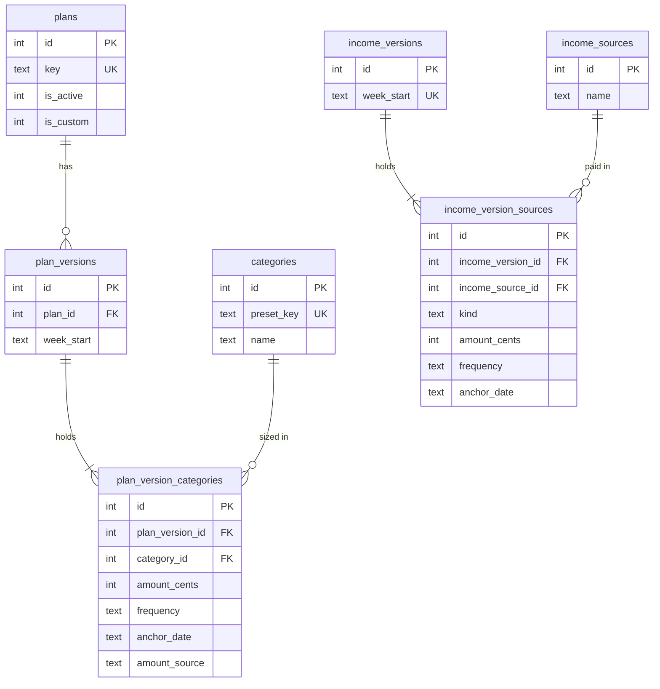
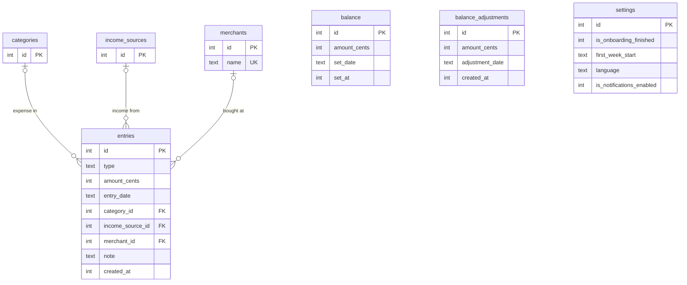
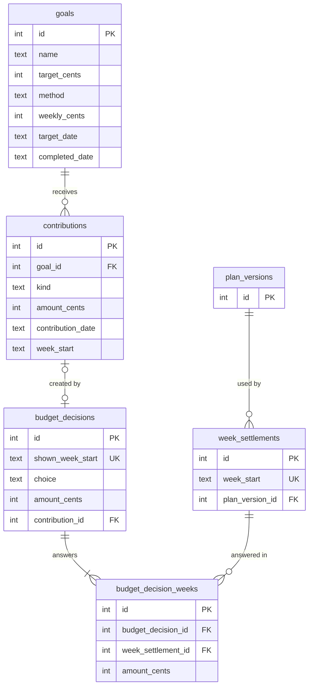

# GambitCS — Data model

Last updated: November 19, 2026.
Purpose: every table, field, type and relation in the local SQLite database, the rules that keep them consistent, and the September 2026 sample walked through them. Product behavior lives in `GambitCS_Decisions_Update.md` (it wins on behavior); layers and folders live in `docs/ARCHITECTURE.md`; coding, backend and security decisions live in `GambitCS_Tech_Decisions.md`. The libraries (expo-sqlite + Drizzle) are logged in `docs/decisions.md`.

---

## 1. The principle

**Store what the user told the app; calculate everything else.** Amounts the user typed, dates they picked, choices they made and the moments things happened are stored. Weekly equivalents, profit, next due dates, each week's result, carry-over, the account balance, Saved, To goals and After goals are calculated by the engines every time, so a stored copy can never disagree with its source.

Two deliberate exceptions, each with its reason:

- **`goals.weekly_cents` is stored even for the target-date method.** It is the amount the user saw and agreed to in the receipt card. Recalculating it every week would change After goals without the user doing anything. It is recalculated only when the goal is saved again.
- **`balance.amount_cents` is the number the user typed.** The app can't read the bank, so the typed number is the anchor the balance formula starts from (section 6.2).

---

## 2. Ground rules

### Money
- Every amount is an **integer number of cents** (`INTEGER`), in a column whose name ends in `_cents`. $12.40 is `1240`. Cents become "$12.40" only on screen.
- **No currency column.** The app only shows "$" and never converts.
- **Amounts are positive, and a column says which way they go** (`entries.type`: `expense` / `income`). Two named exceptions can be negative:
  - the **account balance**, which is calculated and can go below $0;
  - **balance adjustments**, whose signed `amount_cents` is never zero and never counts as Spent or Income.
  - `budget_decision_weeks.amount_cents` is also signed, because it records a week's result: **+ under, − over**, the same sign rule as the screens ("+ means good").
- **One stored amount per thing, per occurrence, in its own frequency.** Rent is stored as `130000`, monthly. Its weekly equivalent ($300) is calculated by the plan engine and never stored.
- **No cent is lost when dividing.** When an amount is split into parts, the leftover cents go to the last part: $25 spread over 3 weeks is 833 + 833 + 834. A single stored rate (`goals.weekly_cents`) is rounded up to the cent instead, and the last Weekly row only adds what's missing (section 6.4).

### Dates and times
- **A day is text `'YYYY-MM-DD'`** (a local day, no time, no time zone), in a column whose name ends in `_date`. SQLite has no date type, and this format sorts and compares correctly as text.
- **A week is stored by its Monday** (`week_start`). The month a week belongs to (the week whose Sunday falls in it) is calculated by the calendar engine, never stored.
- **`created_at` is the moment a row was saved**, in UTC milliseconds (`INTEGER`). It orders entries within a day and drives the balance rule (section 6.2). It never decides the week.
- **Never `new Date('2026-09-13')`.** JavaScript reads it as midnight UTC, which is the day before in Vancouver. All day math goes through `src/lib/dates.ts`, tested with Jest.
- **`today()` is the only source of "today".** In development builds it can be set (the dev clock), for example to Sun, Sep 13, 2026, to replay the sample.
- **A clock time with no day is `'HH:MM'`** text (quiet hours).
- **Anchor dates, not "next" dates.** A bill or a payday stores one real date it falls on plus its frequency; the calendar engine works out every occurrence, past and future. A stored "next" date would go stale the day it passed. Editing "Next due date" in a sheet sets a new anchor.

### Rows don't show a time
Activity, Recent activity and Balance adjustment rows show no time (decided November 19, 2026). `created_at` is still stored for ordering and the balance rule.

---

## 3. Conventions

- **Names:** tables are plural, except `balance` (a one-row table). Columns are snake_case. Drizzle shows them in TypeScript as camelCase (`weekStart`).
- **`id`:** `INTEGER PRIMARY KEY`. No UUIDs: data never merges between phones (no live sync; the account saves the whole file).
- **Yes/no:** `INTEGER` 0/1, always starting with `is_`. Drizzle maps it to `true`/`false`.
- **Fixed lists:** `TEXT` with a `CHECK` listing the allowed values.
- **Every table has `created_at`**, except `balance`, which has `set_at` because its row is replaced on every update.
- **Date checks:** every date column has `CHECK (date(col) IS col)`; a nullable one is written `CHECK (col IS NULL OR date(col) IS col)`. Week columns also check `strftime('%w', col) = '1'` (a Monday). `strftime` alone is not enough: SQLite passes a `CHECK` that evaluates to NULL, so `'banana'` and `'2026-02-30'` would get through (tested).
- **Time checks:** `CHECK (strftime('%H:%M', col) IS col)` accepts `'22:00'` and `'07:00'` and rejects `'7:00'`, `'25:00'`, `'22:00:00'` (tested).
- **Foreign keys** are declared on every link, and the database provider runs `PRAGMA foreign_keys = ON` when it opens the connection (SQLite ignores them otherwise). Default action is no action (a referenced row can't be deleted), except the two listed in section 5: `contributions.goal_id` cascades and `budget_decisions.contribution_id` is set to null.
- **Service rules** are rules the schema can't express; the services check them and Jest tests cover them. Each table lists its own.

---

## 4. ER diagram

Three parts, one per area. A table drawn with only its `id` belongs to another part. Line ends: `||` exactly one, `o|` zero or one, `o{` zero or many, `|{` one or many.

### Plan and income



### What happened

`balance`, `balance_adjustments` and `settings` link to no other table: the balance formula and the app's rules connect them, not foreign keys.



### Goals and weeks



### Links matched by date, not drawn

A foreign key can't say "the newest one on or before", so these are lookups in the engines:

- **The version a week uses:** for each plan, the newest `plan_versions` row whose `week_start` is on or before that week's Monday; for income, the newest `income_versions` row the same way.
- **A Weekly contribution's week:** its `week_start` is the same Monday as that week's `week_settlements` row.
- **An entry's week:** the Monday on or before its `entry_date`.

---

## 5. Tables (17)

### Plan and income

#### `categories`
| Column | Type | Notes |
|---|---|---|
| `id` | INTEGER PK | |
| `preset_key` | TEXT, nullable, unique when set | a suggested category (`'groceries'`); its name comes from i18n, so it follows the app's language |
| `name` | TEXT, nullable | what the user typed (Add your own, or a rename); wins over `preset_key` |
| `created_at` | INTEGER | |

- `CHECK (preset_key IS NOT NULL OR name IS NOT NULL)`.
- Renaming a suggested category sets `name` and keeps `preset_key`. Re-adding a deleted suggestion reuses its row, so its history stays connected.
- **Never deleted.** Old entries point to it. Whether a category exists in a week comes from that week's plan version (section 6.1).
- Service rule: no two **current** categories (in the active version) share a **display name** (`name`, else the translated `preset_key`), ignoring capitals.

#### `income_sources`
| Column | Type | Notes |
|---|---|---|
| `id` | INTEGER PK | |
| `name` | TEXT, not null | "Part-time job" |
| `created_at` | INTEGER | |

- **Never deleted.** Logged income points to it. Whether it exists in a week comes from that week's income version.
- Service rule: no two current sources share a name, ignoring capitals.

#### `plans`
| Column | Type | Notes |
|---|---|---|
| `id` | INTEGER PK | |
| `key` | TEXT, unique: `tight` / `balanced` / `easy` | the name on screen comes from i18n |
| `is_active` | INTEGER 0/1 | a partial unique index `WHERE is_active = 1` allows only one active plan |
| `is_custom` | INTEGER 0/1 | set on the first manual edit; only Reset to default clears it |
| `created_at` | INTEGER | |

Always exactly three rows, written when onboarding finishes. `is_custom` is stored, not derived: a profit-only change makes a plan Custom without pinning any category, and returning the profit to the default doesn't clear it (`Modelo_de_Plan_Reglas.md`, section 3b).

#### `plan_versions`
| Column | Type | Notes |
|---|---|---|
| `id` | INTEGER PK | |
| `plan_id` | INTEGER → `plans` | |
| `week_start` | TEXT, a Monday | the Monday of the week the change was saved |
| `created_at` | INTEGER | |

`UNIQUE (plan_id, week_start)`. Never deleted. See section 6.1 for how versions are written and read.

#### `plan_version_categories`
| Column | Type | Notes |
|---|---|---|
| `id` | INTEGER PK | |
| `plan_version_id` | INTEGER → `plan_versions` | |
| `category_id` | INTEGER → `categories` | |
| `amount_cents` | INTEGER, ≥ 0 | per occurrence, in this row's frequency |
| `frequency` | TEXT: `weekly` / `biweekly` / `monthly` / `yearly` | |
| `anchor_date` | TEXT, nullable | `CHECK ((frequency = 'weekly') = (anchor_date IS NULL))` |
| `amount_source` | TEXT: `plan` / `typed` / `edited` | see below |
| `created_at` | INTEGER | |

- `UNIQUE (plan_version_id, category_id)`: one row per version per category.
- **`amount_source`:**
  - `plan`: the plan sizes it, and it moves when profit changes (redistribution applies to every `plan` row, whatever its frequency);
  - `typed`: the user typed it (onboarding step 2, or a new category); fixed, no tag;
  - `edited`: the user changed it by hand later; fixed, and shows the **Custom** tag.
  - **Pinned = `typed` or `edited`. The Custom tag = `edited`.**
- Frequency and anchor date live here, next to the amount, because the amount means nothing without them ($90 a week becomes $390 a month in one change) and closed weeks must keep the frequency and date they had.
- Service rule: a category's `frequency` and `anchor_date` are the same in all three plans' current versions. A change to either writes a new version for all three plans in one transaction.

#### `income_versions`
| Column | Type | Notes |
|---|---|---|
| `id` | INTEGER PK | |
| `week_start` | TEXT, a Monday, unique | |
| `created_at` | INTEGER | |

One history, shared by all three plans. Never deleted.

#### `income_version_sources`
| Column | Type | Notes |
|---|---|---|
| `id` | INTEGER PK | |
| `income_version_id` | INTEGER → `income_versions` | |
| `income_source_id` | INTEGER → `income_sources` | |
| `kind` | TEXT: `fixed` / `variable` | |
| `amount_cents` | INTEGER, > 0 | per payment; for `variable`, the user's best guess per payment |
| `frequency` | TEXT: `weekly` / `biweekly` / `monthly` | |
| `anchor_date` | TEXT, not null | required for every frequency: onboarding asks for the next payment date |
| `created_at` | INTEGER | |

- `UNIQUE (income_version_id, income_source_id)`.
- Service rule: every income version keeps at least one source (the last one can't be removed).

### What happened

#### `entries`
| Column | Type | Notes |
|---|---|---|
| `id` | INTEGER PK | |
| `type` | TEXT: `expense` / `income` | |
| `amount_cents` | INTEGER, > 0 | |
| `entry_date` | TEXT, indexed | decides the week |
| `category_id` | INTEGER → `categories`, nullable | expenses |
| `income_source_id` | INTEGER → `income_sources`, nullable | income |
| `merchant_id` | INTEGER → `merchants`, nullable | optional, expenses only |
| `note` | TEXT, nullable | `CHECK (note IS NULL OR length(note) <= 100)` |
| `created_at` | INTEGER | ordering within a day; the balance rule |

- Shape check:
  ```sql
  CHECK (
    (type = 'expense' AND category_id IS NOT NULL AND income_source_id IS NULL)
    OR
    (type = 'income' AND income_source_id IS NOT NULL AND category_id IS NULL AND merchant_id IS NULL)
  )
  ```
- Index on `entry_date`: nearly every screen asks for the entries of a week or a month.
- **An edit updates the row in place and keeps `created_at`.** An edit can change the balance's value, but never *whether* the entry counts in it.
- **Deleting removes the row** (the dialog says it can't be undone).
- Service rule: `entry_date` is never after `today()` (the date picker stops at today; checked in the service because of the dev clock).
- **Activity titles:** an expense shows its merchant, or its category name when it has none; an income shows its income source name.

#### `merchants`
| Column | Type | Notes |
|---|---|---|
| `id` | INTEGER PK | |
| `name` | TEXT, `UNIQUE COLLATE NOCASE` | "Uber" and "uber" are one merchant |
| `created_at` | INTEGER | |

- No "last category" column: the suggestion is the category (and amount pattern) of this merchant's newest expenses, calculated. A category no longer current isn't suggested.
- Never deleted in v1 (no screen deletes merchants).

#### `balance` (at most one row)
| Column | Type | Notes |
|---|---|---|
| `id` | INTEGER PK | `CHECK (id = 1)` |
| `amount_cents` | INTEGER, ≥ 0 | the number the user typed; a negative typed balance is out of scope (the fields only take positive amounts) |
| `set_date` | TEXT | the day it was typed |
| `set_at` | INTEGER | the moment it was typed (UTC ms) |

No row means no balance yet: Home shows "Add your balance". Each Update your balance replaces the row. See section 6.2.

#### `balance_adjustments`
| Column | Type | Notes |
|---|---|---|
| `id` | INTEGER PK | |
| `amount_cents` | INTEGER, signed | `CHECK (amount_cents <> 0)`; new typed balance − calculated balance just before |
| `adjustment_date` | TEXT | = the new balance's `set_date` |
| `created_at` | INTEGER | |

A record only: Activity and Recent activity read it; the balance formula, Spent, Income and day totals never do. The first balance (onboarding or "Add your balance") creates no adjustment.

### Goals

#### `goals`
| Column | Type | Notes |
|---|---|---|
| `id` | INTEGER PK | |
| `name` | TEXT, not null | |
| `target_cents` | INTEGER, > 0 | |
| `method` | TEXT: `weekly_amount` / `target_date` | what the user picked in "How do you want to save?" |
| `weekly_cents` | INTEGER, > 0 | stored at save (sections 1 and 6.4) |
| `target_date` | TEXT, nullable | `CHECK ((method = 'target_date') = (target_date IS NOT NULL))`; at least this week's Sunday (service rule) |
| `completed_date` | TEXT, nullable | |
| `created_at` | INTEGER | |

Goals belong to the user, not to a plan: every plan shows the same goals total. Deleting a goal is a **hard delete** that also deletes its contributions: the money is "no longer set aside", so it stops counting.

#### `contributions`
| Column | Type | Notes |
|---|---|---|
| `id` | INTEGER PK | |
| `goal_id` | INTEGER → `goals`, `ON DELETE CASCADE` | |
| `kind` | TEXT: `weekly` / `extra` | Move it to a goal and Add money are both `extra` (the Extra tag) |
| `amount_cents` | INTEGER, > 0 | |
| `contribution_date` | TEXT | Weekly: that week's Sunday. Extra: the day it was made. |
| `week_start` | TEXT, nullable | `CHECK ((kind = 'weekly') = (week_start IS NOT NULL))` |
| `created_at` | INTEGER | |

- `UNIQUE (goal_id, week_start)`: a week can never be counted twice for a goal. Extras have no `week_start`, and SQLite treats NULLs as distinct, so they're never blocked.
- Changing a goal's weekly amount needs no history: each Weekly row keeps its own amount.
- Contributions show in Goal detail's Contributions list, not in Activity, and never change the account balance.

### Weeks

#### `week_settlements` (one per closed week)
| Column | Type | Notes |
|---|---|---|
| `id` | INTEGER PK | |
| `week_start` | TEXT, a Monday, unique | |
| `plan_version_id` | INTEGER → `plan_versions` | the plan and version that week used (the active plan's version when it closed) |
| `created_at` | INTEGER | |

Every closed week gets a row, quiet weeks included. **Handled** is calculated: the sum of the week's `budget_decision_weeks.amount_cents`. Never deleted.

#### `budget_decisions` (one per answered new-week pop-up)
| Column | Type | Notes |
|---|---|---|
| `id` | INTEGER PK | |
| `shown_week_start` | TEXT, a Monday, unique | the week the pop-up showed in; its effects start here |
| `choice` | TEXT: `spread` / `take_all` / `ignore` / `got_it` / `move_to_goal` | |
| `amount_cents` | INTEGER, > 0 | the net amount the pop-up showed |
| `contribution_id` | INTEGER → `contributions`, nullable, `ON DELETE SET NULL` | `CHECK (contribution_id IS NULL OR choice = 'move_to_goal')` |
| `created_at` | INTEGER | |

`shown_week_start` is unique because there's one new-week pop-up per week. It is not the closed week the decision is about: one closed week can get two decisions (Ignore on Sep 7, then Spread on Sep 21 for a late $30), and one decision can answer two weeks (netting). Those links live in `budget_decision_weeks`. If the goal is deleted, the link empties but `amount_cents` stays, so closed weeks never change.

#### `budget_decision_weeks` (which weeks each decision answered)
| Column | Type | Notes |
|---|---|---|
| `id` | INTEGER PK | |
| `budget_decision_id` | INTEGER → `budget_decisions` | |
| `week_settlement_id` | INTEGER → `week_settlements` | |
| `amount_cents` | INTEGER, signed: + under, − over | the part of that week's result this decision answered |
| `created_at` | INTEGER | |

`UNIQUE (budget_decision_id, week_settlement_id)`. This table is the only record of what was answered, so handled can't drift from the decisions. It also gives Home's "i" tooltip and the netting copy the weeks to name.

### Settings

#### `settings` (one row)
| Column | Type | Notes |
|---|---|---|
| `id` | INTEGER PK | `CHECK (id = 1)` |
| `is_onboarding_finished` | INTEGER 0/1 | travels in the saved file: the sign-in rule opens onboarding for a file without it |
| `first_week_start` | TEXT, a Monday | the onboarding week, which is the warm-up week (section 6.3) |
| `language` | TEXT, nullable: `en` / `es` | empty = follow the phone |
| `region` | TEXT, nullable | the phone's region (`CA`, `MX`), saved silently |
| `is_notifications_enabled` | INTEGER 0/1 | "Enable reminders" turns it on; "Not now" leaves it off |
| `notification_every_hours` | INTEGER: 6 / 12 / 24 | default 12 |
| `quiet_from` | TEXT `'HH:MM'` | default `'22:00'` |
| `quiet_to` | TEXT `'HH:MM'` | default `'07:00'`; when `quiet_from` is later than `quiet_to`, quiet hours cross midnight |
| `created_at` | INTEGER | |

---

## 6. Rules that span tables

### 6.1 Version history (plans and income)
- A change saved in the Simulator, Settings › Income & categories or Reset to default writes a version that starts on the **Monday of the current week** ("Applies from this week (Oct 19–25) forward").
- **A second save in the same week keeps the version's id and replaces its category (or source) rows as a set.** Nothing points to those rows, so replacing them is safe. The current week's version is never referenced by a settlement yet, because the week isn't closed.
- **For any week, use the newest version whose `week_start` is on or before that week's Monday.** Closed weeks keep the version they had.
- Adding or removing a category or income source is a new version with or without it. No "hidden from" dates are needed.
- A version holds every category of its plan, one row each. Changing one plan writes a new version for that plan only; a change to a category's frequency or date, or adding or deleting a category, writes new versions for all three plans in one transaction.

### 6.2 The account balance
```
balance = balance.amount_cents
        + income   entries counted
        − expense  entries counted
```
An entry is **counted** when it was logged after the balance was typed (`created_at > balance.set_at`) **and** it isn't dated before that day (`entry_date >= balance.set_date`). Entries dated before the day the balance was typed never count: the bank already had them. Entries logged before the balance was typed never count either: the number the user typed already includes them. Adjustments are never part of the formula, and neither are goals.

**Update your balance** (one transaction):
1. Calculate the balance with the formula.
2. Write `balance_adjustments`: `amount_cents` = new typed balance − that calculated balance; `adjustment_date` = `today()`.
3. Replace the `balance` row: the typed amount, `today()`, and the same moment.

**Add your balance** (no row yet, or the onboarding Current balance) only writes the `balance` row.

### 6.3 Closing a week and the new-week pop-up
1. **At startup in a new week** (the first open on Monday or later, including coming back from the background), one transaction writes, for every closed week without a settlement, **oldest first**:
   - its `week_settlements` row, pointing to the active plan's version for that week;
   - a Weekly `contributions` row for each goal that existed when that week closed and whose `completed_date` is still null (section 6.4), which can complete a goal.
2. **The ledger works out what's pending** for every closed week: its current result (budget − spent, + under / − over) minus its handled (the sum of its `budget_decision_weeks`). A late expense changes the result, never handled.
3. **One pop-up, never two.** The pending amounts are netted into one number:
   - net over → the over-budget pop-up (Spread it out / Take it all this week / Ignore it), only for the over part, as the Decisions update describes;
   - net under → the "spent less" pop-up (Got it / Move it to a goal);
   - exactly $0 → no pop-up; the "i" tooltip explains.
   - Missed weeks (the app wasn't opened for two weeks or more) are netted the same way.
4. **On Save** (one transaction): one `budget_decisions` row; one `budget_decision_weeks` row for every week the pop-up covered, each with that week's current result − its handled so far; for `move_to_goal`, the Extra `contributions` row first, then the decision pointing to it.
5. **Effects on later weeks are calculated** from the decisions, never stored: `spread` takes the amount off this week and the next two (833 + 833 + 834); `take_all` takes it off this week; `ignore` and `got_it` change nothing; `move_to_goal` takes it off this week's carried room. Under-budget room carries forward on its own.
6. **The warm-up week.** The week of `first_week_start` never creates a pop-up or a carry-over, even after a late expense, so finishing onboarding late in a week never produces a misleading "You spent $X less".
7. **Safe to repeat.** If the app closes before the pop-up is answered, the unique rules on `week_settlements.week_start` and `contributions (goal_id, week_start)` stop anything from being written twice, and the pop-up simply shows again.

### 6.4 Goals
- **`weekly_cents` for the target-date method** = (target − Saved) ÷ weeks left, rounded up to the cent, recalculated when the goal is saved again. **Weeks left** counts from the current week through the last week whose Sunday is on or before `target_date`, so every Weekly row lands by the target date.
- **A goal gets a Weekly row for a closed week** if it existed when the week closed and its `completed_date` is null. **The last Weekly row only adds what's missing** to reach the target.
- **`completed_date`** is set in the same transaction as the contribution that first takes Saved to or past the target (Weekly or Extra), and takes that contribution's `contribution_date`. No Weekly rows are written after it.
- **An Extra may go past the target.** The goal then completes in the same transaction.
- **Add money comes from money already saved.** It writes an Extra contribution linked only to its goal; this week's budget doesn't change. *(Closes Decisions update section 7 and ARCHITECTURE section 6, "Where an Extra's money comes from".)*
- **Available to set aside** = account balance − Saved in all goals (deleted goals don't count; they're gone). Calculated. The Add money sheet warns when the amount goes over it; with no balance entered, there's no warning.

---

## 7. Calculated, never stored
- Weekly equivalents (monthly × 12 ÷ 52, biweekly ÷ 2, yearly ÷ 52) and average profit
- Next due dates and paydays, and every occurrence in a week
- The month a week belongs to
- Each week's budget, Spent, result, handled, carry-over and the effects of decisions
- The account balance
- Saved, To goals, After goals, progress and "on track for"
- Available to set aside
- Merchant suggestions
- The default amounts of each plan (for Reset to default and the cap), from the plan engine

## 8. Outside the database
| What | Where | Why |
|---|---|---|
| Name and email | the account (Firebase Auth) | they belong to the account; without one there's no name |
| "Waiting for email verification" | the phone's secure store | it's about this phone's sign-in, so it never goes into the saved file |
| Notification permission | iOS, once per phone | it can't travel to a new phone |
| The dev clock | development builds only | it can never end up in a real saved file |
| The saved file's format version | Drizzle's migrations table | Drizzle already records which migrations have run |

## 9. Out of scope for v1
- One-time categories or income (no `once` frequency). Planned expenses stay removed (Decisions update, Stage 3).
- Yearly income.
- A negative typed balance (the calculated balance can still go below $0).
- Deleting merchants.

---

## 10. Sample walkthrough: September 2026

The sample from the Decisions update (Balanced, today = Sun, Sep 13, 2026) walked through the tables. **Sample assumptions:** payday is Friday (each real user types their own); one entry per category, with dates chosen inside each week (only the totals come from the sample).

### Stop 1: the starting state (before Mon, Aug 31)

- **`settings`:** onboarding finished; `first_week_start` `'2025-09-29'` (the warm-up week); language empty; region `'CA'`; notifications on, every 12 hours, quiet `'22:00'`–`'07:00'`.
- **`plans`:** Tight, Balanced, Easy; only Balanced is active; none is Custom.
- **`plan_versions`:** one per plan, all from `'2025-09-29'`.
- **`plan_version_categories`**, Balanced (all 8 categories are suggestions with a `preset_key`):

| Category | amount_cents | frequency | anchor_date | amount_source |
|---|---|---|---|---|
| Groceries | 8500 | weekly | — | plan |
| Day off | 4500 | weekly | — | plan |
| Fun | 4000 | weekly | — | plan |
| School | 6000 | weekly | — | plan |
| Rent | 130000 | monthly | 2025-10-01 | typed |
| Gym | 4300 | monthly | 2025-10-10 | plan |
| Phone | 6500 | monthly | 2025-10-15 | typed |
| Car insurance | 156000 | yearly | 2026-03-20 | typed |

  Weekly categories $230, monthly bills $1,408. Average profit: $700 − all categories as weekly equivalents = $115.08, shown as **$115** ✓. Gym is plan-sized on purpose: the sample user left its amount empty in onboarding, and the Decisions update's "fixed amounts take $1,495" (Rent + Phone + Car insurance ÷ 12) leaves it out. Tight and Easy have the same 8 categories with their own amounts.
- **Income:** Part-time job, one version from `'2025-09-29'`: `fixed`, `70000`, `weekly`, anchored Fri, Oct 3, 2025.
- **`balance`:** `512050`, `'2026-08-30'`, Sun, Aug 30, evening (from an earlier Update your balance).
- **Goals** (weekly-amount method):

| Goal | Target | Weekly | Created (week of) | Weekly rows | Extras | Saved before Sep 7 |
|---|---|---|---|---|---|---|
| Emergency fund | $1,200 | $10 | Oct 27, 2025 | 44 × $10 = $440 | — | $440 |
| New laptop | $1,500 | $10 | Dec 1, 2025 | 39 × $10 = $390 | $900 Add money, Jan 5, 2026 | $1,290 |
| Trip to Mexico | $2,000 | $30 | Mar 23, 2026 | 23 × $30 = $690 | $100 Add money, Jun 1, 2026 | $790 |

- **`week_settlements`:** 48 rows, Sep 29, 2025 to Aug 24, 2026, all answered.

### Stop 2: the week of Aug 31 – Sep 6

| entry_date | type | amount_cents | category / source |
|---|---|---|---|
| 2026-08-31 | expense | 9800 | Groceries |
| 2026-09-01 | expense | 130000 | Rent |
| 2026-09-02 | expense | 6000 | School |
| 2026-09-04 | income | 70000 | Part-time job |
| 2026-09-04 | expense | 4700 | Fun |
| 2026-09-06 | expense | 5000 | Day off |

Calculated: budget **$1,530** ($230 + Rent, due Sep 1); spent **$1,555**; the week ends **$25 over** ✓. Projected profit −$830, actual −$855. Aug 31 counts in September (its week's Sunday is Sep 6). No settlement yet.

### Stop 3: Mon, Sep 7

- **Startup:** `week_settlements` `'2026-08-31'` → Balanced's version. Weekly contributions dated `'2026-09-06'`, week `'2026-08-31'`: Trip $820, Laptop $1,300, Emergency $450 ✓.
- **Pending:** −$25 result, $0 handled → the over-budget pop-up.
- **Ignore it → Save:** `budget_decisions` (`'2026-09-07'`, `ignore`, `2500`); `budget_decision_weeks` (week `'2026-08-31'`, −2500).
- Calculated: Sep 7–13 budget **$273** ($230 + Gym) ✓; tooltip "You chose to ignore it, so this week's budget stays at $273." ✓; Calendar shows Difference −$25 for Aug 31–Sep 6.

### Stop 4: the week of Sep 7 – 13

| entry_date | type | amount_cents | category / source | logged |
|---|---|---|---|---|
| 2026-09-07 | expense | 4800 | Groceries | Mon |
| 2026-09-10 | expense | 4300 | Gym | Thu morning |
| 2026-09-11 | income | 70000 | Part-time job | Fri |
| 2026-09-12 | expense | 500 | Fun | Sat |
| 2026-09-13 | expense | 2200 | Day off | Sun afternoon |

- **Thu, Sep 10, 9:15 PM, Update your balance:** calculated balance $5,120.50 − $855 (the Aug 31 week) − $48 − $43 = **$4,174.50**; typed **$4,159.50** → `balance_adjustments` (−1500, `'2026-09-10'`); `balance` → `415950`, `'2026-09-10'`, Thu 9:15 PM.
- **Sun, Sep 13, Home:** $4,159.50 + $700 − $5 − $22 = **$4,832.50** ✓ (Groceries and Gym were logged before Thursday's update, so they don't count again).
- **Sun, Sep 13, 9 PM, Update your balance** (after Day off was logged): typed **$4,792.50** → `balance_adjustments` (−4000, `'2026-09-13'`); `balance` → `479250`, `'2026-09-13'`, Sun 9 PM.
- Calculated: budget $273 · spent $118 · **Left $155** ✓; September projected **$2,328**, spent **$1,673**, **$655 left** ✓; income received **$1,400** ✓.

### Stop 5: Mon, Sep 14

- **Startup:** `week_settlements` `'2026-09-07'` → Balanced's version. Weekly contributions dated `'2026-09-13'`, week `'2026-09-07'`: Trip $850, Laptop $1,310, Emergency $460.
- **Pending:** +$155 → the "spent less" pop-up; Home behind it shows $450 left of $450 ($295 + $155) ✓.
- **Move it to a goal → Trip to Mexico → Save:** `contributions` (Trip, `extra`, 15500, `'2026-09-14'`) → Saved **$1,005**; `budget_decisions` (`'2026-09-14'`, `move_to_goal`, 15500, → that contribution); `budget_decision_weeks` (week `'2026-09-07'`, +15500).
- Calculated: this week's budget $295 + $155 − $155 = **$295** ✓; Trip **50%**, on track for **May 9, 2027** (the last Weekly row adds $5); balance unchanged at **$4,792.50** ✓.

**Result:** every number on the September screens comes out of these tables, and every balance figure can be reproduced from the Aug 30 row.

---

## 11. To carry into the Decisions update
- Rows in Activity, Recent activity and Balance adjustment show no time.
- Add money comes from money already saved (closes Decisions update section 7, "Where an Extra's money comes from", and ARCHITECTURE section 6).
- Missed weeks are netted into one new-week pop-up.
- The Add money sheet warns when the amount goes over "available to set aside".
- The onboarding week is a warm-up week: no new-week pop-up and no carry-over.
- A target date must be at least this week's Sunday.
- An Extra may take a goal past its target; the goal completes.
- Activity titles: an expense with no merchant shows its category name; income shows its source name.
- Variable income is a best guess per payment (corrects the Simulator line "uses the monthly amount the user entered").
- No one-time items and no yearly income in v1.
- Sample fixes: Trip to Mexico is **$1,005 (50%)** on Sep 14, not $975 (49%); New laptop and Emergency fund are **$1,310** and **$460** on Sep 14; the goals' starting Saved includes their creation weeks and two Add money Extras (section 10).
- Open: the "Uber, $12.40, Sep 11" dialog example isn't in the sample's $118 split for Sep 7–13. Move the example to another week, or add it to the split.
